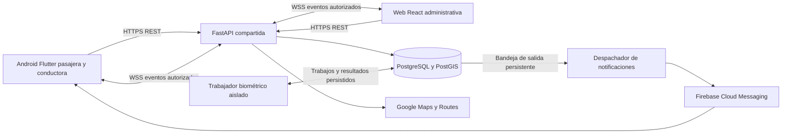

# Arquitectura de la aplicación y la web

Base técnica revisada el 24/11/2026, versión 0.5. Se prioriza un sistema académico Android y un backend compartido para permitir el desarrollo paralelo de la web. La propuesta debe probarse en F2 antes de fijar versiones y dimensionar producción.

## Tecnologías seleccionadas como base de trabajo

| Componente | Tecnología | Responsabilidad |
|---|---|---|
| Android | Flutter y Dart estables | Una app, interfaces por perfil y código compartido |
| Navegación y estado | go_router y Riverpod | Navegación y estado fuera de widgets; validar versiones al iniciar |
| HTTP y sesión | Dio y flutter_secure_storage | Llamadas REST, errores y almacenamiento protegido de credenciales |
| GPS y cámara | geolocator, camera y servicio nativo de ubicación | Captura con permisos; el plugin de GPS por sí solo no garantiza segundo plano |
| Reintentos locales | SQLite con Drift | Cola de posiciones con identificadores y borrado tras confirmación |
| Mapas | google_maps_flutter y Google Routes | Visualización y rutas; clave del servidor fuera de la APK |
| Notificaciones | firebase_messaging y FCM | Avisos complementarios; no garantiza entrega inmediata |
| Web | React, TypeScript y Vite | Portal administrativo que consume la misma API |
| Backend | Python 3.12, FastAPI, Uvicorn, Pydantic | Reglas del negocio, autorización, REST, WebSocket y OpenAPI |
| Persistencia | PostgreSQL 16 con PostGIS 3, SQLAlchemy y Alembic | Relaciones, geografía, integridad y migraciones |
| Autenticación | JWT de acceso corto y refresh revocable | Misma identidad para clientes; roles y acceso a cada viaje en servidor |
| Biometría | OpenCV, YuNet y SFace como candidatos | Comparación uno a uno; detección de vida como componente separado |
| Entrega | GitHub Actions y Docker | Verificación, construcción y reproducción |

Esta tabla fija familias y componentes para el arranque. Cada gestor resolverá versiones exactas estables en F2 y se registrarán locks. Si una librería no es compatible, tramitar la sustitución. La detección de vida queda como decisión de viabilidad: no presentar OpenCV o una detección de parpadeo como solución anti suplantación completa.

## Infraestructura recomendada

**Desarrollo:** Windows, VS Code, Flutter SDK, Android Studio y dos teléfonos Android físicos; Docker Desktop con WSL2 para PostgreSQL/PostGIS y API si el equipo lo soporta. También se puede ejecutar Python nativo con una base PostgreSQL local equivalente. No instalar herramientas de pago ni contratar servicios automáticamente.

**Integración y piloto:** Render para reducir mantenimiento del sistema operativo: API en servicio siempre activo, trabajador biométrico independiente, PostgreSQL administrado con PostGIS y web estática. API, trabajador y DB en la misma región y red privada. Una instancia API y un trabajador al comienzo; memoria del trabajador dimensionada tras medir inferencia (objetivo inicial de 2 GB, no garantía de suficiencia). TLS público; base sin credenciales en los clientes. No usar disco efímero como almacén de imágenes.

Los trabajos biométricos y las alertas se persistirán en tablas con estado y reintentos. El trabajador usa reclamación de trabajos y bloqueo de filas; para este volumen no se añade Redis. La bandeja de salida se escribe en la misma transacción del cambio de estado. Si aumenta el volumen, introducir cola externa mediante una nueva decisión.

La plantilla biométrica, si se conserva, se cifra a nivel de aplicación y se guarda en PostgreSQL con acceso limitado; las claves van en el gestor de secretos del entorno. Las capturas temporales se procesan y eliminan conforme a la política que se apruebe. Si la solución de detección de vida exige almacenamiento de objetos, añadir bucket privado, ciclo de vida y costo antes de contratarlo. No almacenar rostros en el repositorio ni registrar su contenido en logs.

**Por qué Render:** soporta WebSockets y PostGIS con despliegue desde GitHub, y evita administrar un VPS durante el proyecto académico. Es una elección por simplicidad operativa, no una afirmación de que sea el proveedor más barato. El plan gratuito puede servir para demostraciones; su suspensión por inactividad y limitaciones de persistencia lo hacen inadecuado para las pruebas de latencia y alertas del piloto.

## Entornos y accesos

- local: datos sintéticos, puertos API 8000 y web 5173, DB solo en localhost.
- integration: prueba conjunta móvil y web, sin mezclar datos con el piloto.
- pilot: participantes autorizadas, datos y secretos propios, despliegue de una etiqueta revisada.
- Ramas main y codex/<tarea>; las dos aplicaciones comparten versión de contratos. Despliegues del piloto deliberados, sin publicar cada commit automáticamente.
- WebSocket con cookie segura del mismo sitio o ticket de un uso y vida corta emitido por REST; nunca JWT de larga duración en la URL.
- Copia de seguridad diaria cuando haya datos reales y restauración ensayada; definir pérdida de datos tolerable y tiempo de recuperación antes del piloto.

## Fuentes oficiales

- Flutter, separación de capas y repositorios: https://docs.flutter.dev/app-architecture/recommendations
- FastAPI y WebSocket: https://fastapi.tiangolo.com/advanced/websockets/
- Render y WebSockets: https://render.com/docs/websocket
- Extensiones PostGIS: https://render.com/docs/postgresql-extensions
- Límites del nivel gratuito: https://render.com/docs/free
- Planes de cómputo y precios: https://render.com/docs/compute-plans y https://render.com/pricing
- Notificaciones FCM: https://firebase.google.com/products/cloud-messaging
- Android y servicios de ubicación: https://developer.android.com/develop/background-work/services/fgs/restrictions-bg-start
- OpenCV y reconocimiento: https://docs.opencv.org/4.x/d0/dd4/tutorial_dnn_face.html

Revisión del 24/11/2026: se mantiene la arquitectura objetivo para el sistema completo. La selección de Render es una recomendación pendiente de dimensionamiento y cobertura presupuestaria, no un despliegue. PostGIS y WebSocket se contrastaron en la documentación oficial del proveedor en esta revisión. Separación UI y datos contrastada con Flutter; permisos de servicios de ubicación con Android. Las versiones mayores antes propuestas (Python 3.12, PostgreSQL 16 y PostGIS 3) son una base de compatibilidad por comprobar, no una afirmación de ser las últimas versiones estables. Fijar versiones y locks en F2.

## Base móvil implementada en CAM 2026 007
Flutter Android 3.50.1 con material_ui oficial 1.11.1, Riverpod, GoRouter y SharedPreferencesAsync solo para apariencia local. Capas y versiones en [MOVIL_APARIENCIA.md](MOVIL_APARIENCIA.md). No se crea identidad local alternativa ni API de sincronización de color; backend y contratos permanecen sin cambios.

## Contrato de alta v2

CAM-2026-010 prepara el registro en /api/v2, con v1 de diseño conservado y [migración](Contratos/MIGRACION_REGISTRO_V2.md). No despliega otra API independiente ni duplica identidades. La implementación futura debe persistir cuenta, credencial protegida, consentimiento e idempotencia atómicamente, con unicidad de contactos y diagnóstico fuera de la dependencia fallida. Servicios y conexión Neon aún no implementados en este paso.

## Base API01 implementada

CAM-2026-011. FastAPI y Psycopg/SQLAlchemy reales, esquema kora y migración Alembic; ejecución reproducible con lock y PostgreSQL/PostGIS para pruebas. [BASE_API.md](BASE_API.md). La instancia API no ejecuta DDL ni concede roles al arrancar. API01 solo ofrece salud, preparación y registro cerrado; no implementa transacciones de alta, GPS, biometría o alertas. El servicio y el operador tienen variables de conexión separadas y TLS exigido fuera de local. PostGIS 3.7 se fija para una base nueva desechable de pruebas, sin migrar versiones de datos existentes.

## Base de desarrollo Neon DB01

27/11/2026 · DB01 · CAM-2026-012. Base separada kora_dev creada en la misma rama Neon, sin alterar tablas de neondb. PostgreSQL 18.7/PostGIS 3.6.4, revisión 0001_api_base, seis tablas vacías y comprobación Alembic sin deriva. Conexiones locales separadas: pooler con rol de ejecución nuevo y directo con propietario para migraciones. TLS cliente verificado; credenciales solo en .env ignorado. /health/ready responde 200 desde comprobación HTTP en proceso; registro sigue deshabilitado y POST devuelve 503. No se ejecutó la suite destructiva contra Neon ni se desplegó API o conectó la APK. La suite completa anterior sigue limitada a PostgreSQL 16 de CI. Rotación de contraseña propietaria, revisión de John, consentimiento/contactos y revisión visual Word pendientes. Guía en NEON_DESARROLLO.md y evidencia saneada en DB01_EVIDENCIA_NEON.json. No se cierra fase ni se cambian presupuesto, fechas o capacidad.

Neon se utiliza para desarrollo; no se declara contratado o desplegado el piloto de Render. La base separada comparte rama y cómputo; revisar cuotas, región y aislamiento antes de datos reales.
