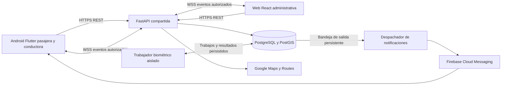

# Arquitectura de la aplicación y la web

Decisión técnica de trabajo del 18/11/2026. Se prioriza un prototipo académico Android y un backend compartido para permitir el desarrollo paralelo de la web. La propuesta debe probarse en F2 antes de fijar versiones y dimensionar producción.

Actualización CAM-2026-004: esta es la arquitectura objetivo del proyecto completo. El [plan de diciembre](ENTREGA_DICIEMBRE.md) propone una entrega mínima y presupuesto de un mes; no presupone contratar trabajador biométrico ni completar todas las capacidades descritas aquí en esa ventana. Revisar alcance antes de implementar o desplegar.

## Tecnologías seleccionadas como base de trabajo

| Componente | Tecnología | Responsabilidad |
|---|---|---|
| Android | Flutter y Dart estables | Una app, interfaces por perfil y código compartido |
| Navegación y estado | go_router y Riverpod | Navegación y estado fuera de widgets; validar versiones al iniciar |
| HTTP y sesión | Dio y flutter_secure_storage | Llamadas REST, errores y almacenamiento protegido de credenciales |
| GPS y cámara | geolocator, camera y servicio nativo de ubicación | Captura con permisos; el plugin de GPS por sí solo no garantiza segundo plano |
| Reintentos locales | SQLite con Drift | Cola de posiciones con identificadores y borrado tras confirmación |
| Mapas | google_maps_flutter y Google Routes | Visualización y rutas; clave del servidor fuera de la APK |
| Notificaciones | firebase_messaging y FCM | Avisos complementarios; no garantiza entrega inmediata |
| Web | React, TypeScript y Vite | Portal administrativo que consume la misma API |
| Backend | Python 3.12, FastAPI, Uvicorn, Pydantic | Reglas del negocio, autorización, REST, WebSocket y OpenAPI |
| Persistencia | PostgreSQL 16 con PostGIS 3, SQLAlchemy y Alembic | Relaciones, geografía, integridad y migraciones |
| Autenticación | JWT de acceso corto y refresh revocable | Misma identidad para clientes; roles y acceso a cada viaje en servidor |
| Biometría | OpenCV, YuNet y SFace como candidatos | Comparación uno a uno; detección de vida como componente separado |
| Entrega | GitHub Actions y Docker | Verificación, construcción y reproducción |

Esta tabla fija familias y componentes para el arranque. Cada gestor resolverá versiones exactas estables en F2 y se registrarán locks. Si una librería no es compatible, tramitar la sustitución. La detección de vida queda como decisión de viabilidad: no presentar OpenCV o una detección de parpadeo como solución anti suplantación completa.

## Infraestructura recomendada

**Desarrollo:** Windows, VS Code, Flutter SDK, Android Studio y dos teléfonos Android físicos; Docker Desktop con WSL2 para PostgreSQL/PostGIS y API si el equipo lo soporta. También se puede ejecutar Python nativo con una base PostgreSQL local equivalente. No instalar herramientas de pago ni contratar servicios automáticamente.

**Integración y piloto:** Render para reducir mantenimiento del sistema operativo: API en servicio siempre activo, trabajador biométrico independiente, PostgreSQL administrado con PostGIS y web estática. API, trabajador y DB en la misma región y red privada. Una instancia API y un trabajador al comienzo; memoria del trabajador dimensionada tras medir inferencia (objetivo inicial de 2 GB, no garantía de suficiencia). TLS público; base sin credenciales en los clientes. No usar disco efímero como almacén de imágenes.

Los trabajos biométricos y las alertas se persistirán en tablas con estado y reintentos. El trabajador usa reclamación de trabajos y bloqueo de filas; para este volumen no se añade Redis. La bandeja de salida se escribe en la misma transacción del cambio de estado. Si aumenta el volumen, introducir cola externa mediante una nueva decisión.

La plantilla biométrica, si se conserva, se cifra a nivel de aplicación y se guarda en PostgreSQL con acceso limitado; las claves van en el gestor de secretos del entorno. Las capturas temporales se procesan y eliminan conforme a la política que se apruebe. Si la solución de detección de vida exige almacenamiento de objetos, añadir bucket privado, ciclo de vida y costo antes de contratarlo. No almacenar rostros en el repositorio ni registrar su contenido en logs.

**Por qué Render:** soporta WebSockets y PostGIS con despliegue desde GitHub, y evita administrar un VPS durante el proyecto académico. Es una elección por simplicidad operativa, no una afirmación de que sea el proveedor más barato. El plan gratuito puede servir para demostraciones; su suspensión por inactividad y limitaciones de persistencia lo hacen inadecuado para las pruebas de latencia y alertas del piloto.

## Entornos y accesos

- local: datos sintéticos, puertos API 8000 y web 5173, DB solo en localhost.
- integration: prueba conjunta móvil y web, sin mezclar datos con el piloto.
- pilot: participantes autorizadas, datos y secretos propios, despliegue de una etiqueta revisada.
- Ramas main y codex/<tarea>; las dos aplicaciones comparten versión de contratos. Despliegues del piloto deliberados, sin publicar cada commit automáticamente.
- WebSocket con cookie segura del mismo sitio o ticket de un uso y vida corta emitido por REST; nunca JWT de larga duración en la URL.
- Copia de seguridad diaria cuando haya datos reales y restauración ensayada; definir pérdida de datos tolerable y tiempo de recuperación antes del piloto.

## Fuentes oficiales consultadas el 18/11/2026

- Flutter, separación de capas y repositorios: https://docs.flutter.dev/app-architecture/recommendations
- FastAPI y WebSocket: https://fastapi.tiangolo.com/advanced/websockets/
- Render y WebSockets: https://render.com/docs/websocket
- Extensiones PostGIS: https://render.com/docs/postgresql-extensions
- Límites del nivel gratuito: https://render.com/docs/free
- Planes de cómputo y precios: https://render.com/docs/compute-plans y https://render.com/pricing
- Notificaciones FCM: https://firebase.google.com/products/cloud-messaging
- Android y servicios de ubicación: https://developer.android.com/develop/background-work/services/fgs/restrictions-bg-start
- OpenCV y reconocimiento: https://docs.opencv.org/4.x/d0/dd4/tutorial_dnn_face.html
